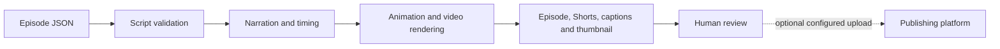

<p align="center"></p>

[Regan Yates](https://github.com/rjyates) · [Homelab](https://github.com/rjyates/homelab)


# Lightbulb Lab — content production pipeline

A Python pipeline that turns structured episode scripts into narrated animation, short-form clips, thumbnails, captions, and publishing metadata. It combines reusable visual templates with a review-oriented media workflow.

**Status:** evolving production tooling. The local episode checker passed for the 17 bundled episode definitions on October 22, 2026. No paid voice generation, full render, upload, scheduled job, or notification was executed during this documentation review.

## Pipeline



## What the code supports

- Structured scenes, narration text, animation poses, timed explainer cards, and short-form ranges.
- Reusable character/room artwork, transitions, captions, and thumbnail generation.
- Narration through ElevenLabs or a supplied audio file, as configured.
- FFmpeg-based video work and local output/state tracking.
- Optional YouTube upload and phone notification integrations.
- Linux/systemd installation scripts for a recurring workflow, when deliberately enabled.

The code can perform external actions when configured. A diagram is not an enforced approval mechanism: keep upload disabled until you intend to use it and review the relevant configuration.

## Start with local validation

Create an isolated Python environment and install [requirements.txt](requirements.txt), then run:

```text
python -m lightbulb.check
python -m lightbulb.weekly --dry-run
```

The checker validates scripts; the dry-run describes the selected workflow. Rendering additionally needs FFmpeg/ffprobe and the repository's fonts/assets. Voice generation can consume provider credits; a quick render is not necessarily a free or offline operation.

### VS Code verification

Create `.venv` with Python 3.12 and install the existing requirements:

```powershell
py -3.12 -m venv .venv
.\.venv\Scripts\python.exe -m pip install -r requirements.txt
.\.venv\Scripts\python.exe -X utf8 -B -m lightbulb.check
```

On macOS/Linux, use `python3 -m venv .venv` and `.venv/bin/python` for installation and validation. In VS Code, select this environment with **Python: Select Interpreter**, then run **Tasks: Run Test Task → Verify episode scripts**. The task validates bundled episode definitions locally; it does not generate narration, render videos, upload, or enable scheduling. Passing this check does not establish publishing readiness or validate every pipeline stage.

The task enables Python UTF-8 mode so episode files are read consistently on Windows. The repository shares the manual task; machine-specific `.vscode/settings.json` remains Git-excluded. No task runs automatically when the folder opens.

See [operations and configuration](docs/operations.md) before enabling scheduling or external services. This README does not claim that a timer is currently installed or a channel is publishing automatically.

## Source map

| Location | Responsibility |
| :--- | :--- |
| [episodes/](episodes/) | Structured scripts; [format reference](episodes/FORMAT.md) |
| [lightbulb/check.py](lightbulb/check.py) | Episode/schema consistency checks |
| [lightbulb/weekly.py](lightbulb/weekly.py) | Workflow orchestration and output state |
| `lightbulb/engine.py`, `cards.py`, `characters.py`, `room.py` | Timeline and animation elements |
| `lightbulb/video.py`, `voice.py`, `thumbnail.py` | Media-generation stages |
| `lightbulb/youtube.py`, `notify.py` | Optional external integrations |
| [systemd/](systemd/) | Optional service/timer definitions |
| [docs/autonomy/proposal.md](docs/autonomy/proposal.md) | Proposed (not deployed) design for autonomous operation; decisions in [docs/decisions/](docs/decisions/) |

## Ownership, privacy, and reuse

Runtime `config.env`, OAuth tokens, secrets, output, and supplied episode audio are Git-excluded. Exclusion does not protect credentials that were previously committed. Review generated media and metadata before any upload.

This repository was public until 2026-10-28, when the owner made it private; its earlier history may still exist in copies made while it was public. Asset provenance and redistribution rights need review before wider reuse; no new software or media license is asserted.

Existing music attribution is preserved: **“Nebula” by The Grey Room / Density & Time**, from the YouTube Audio Library. Verify applicable terms for music, voice, fonts, and artwork before publishing or commercial reuse; no current free-tier entitlement or monetization permission is claimed here.
