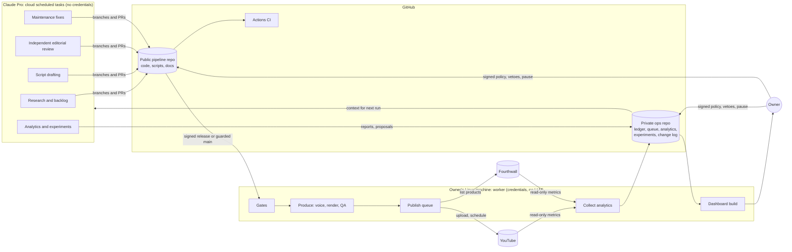
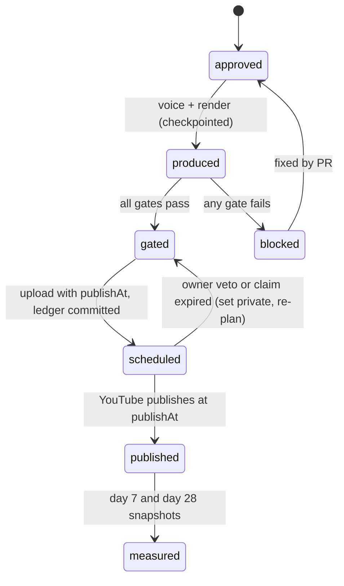
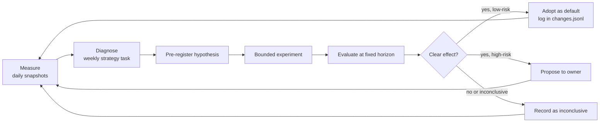

# Autonomous operations: architecture and implementation proposal

[Overview](../../README.md) · [Operations](../operations.md) · [ADR 0001](../decisions/0001-split-agent-and-worker.md)

- **Status:** Proposed. Nothing in this document has been deployed, scheduled or enabled.
- **Date:** 2026-10-28
- **Owner decisions needed:** see [section 12](#12-decisions-the-owner-needs-to-make-now).

## Contents

1. [Summary](#1-summary)
2. [Audit of what exists](#2-audit-of-what-exists)
3. [Claude Pro capabilities and limitations](#3-claude-pro-capabilities-and-limitations)
4. [Recommended architecture](#4-recommended-architecture)
5. [Autonomous workflows](#5-autonomous-workflows)
6. [Quality and safety gates](#6-quality-and-safety-gates)
7. [Permissions model](#7-permissions-model)
8. [Expected recurring costs](#8-expected-recurring-costs)
9. [Continuous improvement](#9-continuous-improvement)
10. [Milestones](#10-milestones)
11. [Testing and launch criteria](#11-testing-and-launch-criteria)
12. [Decisions the owner needs to make now](#12-decisions-the-owner-needs-to-make-now)
13. [What will still require the owner](#13-what-will-still-require-the-owner)
14. [Unverified assumptions and open questions](#14-unverified-assumptions-and-open-questions)

---

## 1. Summary

Lightbulb Lab already has most of the *production* half of an autonomous media business: a working script → narration → animation → Shorts → thumbnail → metadata pipeline, and three products on a storefront. It also already ran a Claude scheduled task for 17 nights that researched topics and drafted scripts. That experiment shows the real bottleneck clearly: **the agent produced six drafts, the owner had to review every one, the queue stalled, and the agent stopped drafting.** Autonomy failed on trust and approval, not on generation.

The proposal is therefore built around one idea: **replace per-item owner approval with measurable gates and an owner-approved policy, and make the system structurally unable to exceed that policy.**

The recommended shape:

- **Agent (Claude Code cloud scheduled tasks, on the existing Pro plan).** Research, scripts, independent editorial review, analytics interpretation, experiment design and code fixes. It works only through Git branches, pull requests and issues. It holds **no** publishing, storefront or payment credentials.
- **Worker (deterministic Python on an always-on Linux machine you already own).** Validates, narrates, renders, runs quality gates, uploads, schedules, lists products and collects analytics. It holds the credentials, makes **no** LLM calls, and runs only code from owner-signed releases (with a narrow, path-guarded exception for low-risk fixes later).
- **Records (Git).** This public repository keeps code, scripts and documentation. A new **private** operations repository keeps the publishing ledger, queue, analytics, experiments, change log and dashboard data.
- **Content buffer.** The worker keeps three or more weeks of finished, gated videos scheduled ahead. Claude usage limits, a bad night or an outage then delay *new* work without stopping publication.

Expected additional recurring cost: **$0** if a free local voice is acceptable, or about **$5–6/month** if the ElevenLabs voice stays (see [section 8](#8-expected-recurring-costs); the free ElevenLabs tier does not allow commercial use).

The two hard external blockers for unattended publishing are **YouTube's API compliance audit** (until it passes, every API upload is locked to private) and the **voice licensing decision**. Both need owner action and should start immediately because they have lead time.

---

## 2. Audit of what exists

Audit performed 2026-10-28 by reading the repository at `9a69c6e`. No narration, render, upload, notification or scheduler was run. `python -m lightbulb.check` passed for all 17 episodes.

### 2.1 Content inventory

| Series | Episodes | Status in JSON |
| :--- | :--- | :--- |
| Tech from Scratch | ep01–ep06 | ep01–02 `done`, ep03–06 `ready` |
| Fix It Friday | fif01–fif11 | fif01–05 `ready`, fif06–11 `draft` |

- 9 episodes are `ready`: about 9 weeks of buffer at one episode per week, or 4–5 weeks at two (one per series).
- Scripts are 1,270–1,910 characters, 9–14 scenes, each with 1–2 Shorts. Format is documented in [episodes/FORMAT.md](../../episodes/FORMAT.md).
- **No episode records its sources.** The nightly reports cite sources, but the JSON has no `sources` field, so accuracy cannot be checked mechanically, and time-sensitive claims (Windows 10 ESU dates, Medicare enrollment windows, iOS versions) have no expiry date.
- fif06–fif11 are timely scam/safety topics written by the nightly agent. Several are time-bound (Medicare Open Enrollment ends Dec 7; election scams closed Nov 3) and are losing value while they wait for review.

### 2.2 Production pipeline (`lightbulb/`, about 1,800 lines)

| Area | What exists | Gaps relevant to autonomy |
| :--- | :--- | :--- |
| Orchestration ([weekly.py](../../lightbulb/weekly.py)) | Picks the next `ready` episode of one series, renders everything, writes `metadata.json` and `UPLOAD-ME.txt`, optionally uploads, records `state.json`, sends an ntfy notification. `--dry-run`, `--quick`, `--episode`. | One series per run. State lives in the output folder, separate from `status` in the JSON (two sources of truth). No stage checkpoints. No queue or schedule concept. |
| Narration ([voice.py](../../lightbulb/voice.py)) | ElevenLabs with timestamps; reuses a cached take; supplied audio file in `episodes/audio/` wins; free-credit check. | Free tier is non-commercial (see 2.5). No check that the audio actually says the script. |
| Rendering ([engine.py](../../lightbulb/engine.py), [video.py](../../lightbulb/video.py), cards, characters, room) | Pillow frames piped to FFmpeg, parallel parts, ducked music, SFX cues, captions, vertical Shorts with end card. | Uses `multiprocessing` **fork**, so rendering runs on Linux/macOS/WSL only, not native Windows. No output validation at all: a black, silent or truncated file would be uploaded. |
| Thumbnails ([thumbnail.py](../../lightbulb/thumbnail.py)) | Brand-sheet characters plus tilted text. | No size/contrast/overflow checks. |
| Metadata | Title, description with links, chapters, tags, SRT captions, pinned comment, TikTok caption. | SRT files are produced but not uploaded (no `captions.insert`). Length limits are truncated silently. |
| Checks ([check.py](../../lightbulb/check.py)) | Schema, poses, card types, icons, `at` words, Short ranges. | No unit tests, no CI workflow, no render or media tests. |
| Promo ([promo.py](../../lightbulb/promo.py)) | Music-only vertical promo for the three guides. | Product names and prices are hard-coded here **and** listed in `links.json`; they will drift. |
| Legacy (`legacy/ep01/`) | First-episode scripts. | Reference only. |

### 2.3 YouTube integration ([youtube.py](../../lightbulb/youtube.py))

- OAuth installed-app flow, token on disk; `videos.insert` (resumable), thumbnail, playlist add. `publish_at` is supported by the function but never used.
- Upload is **off by default** (`YOUTUBE_UPLOAD=false`); without it the pipeline leaves a folder for manual upload. The code comments note that the Google Cloud project has not passed YouTube's API audit, so API uploads would be locked to private anyway.
- **Not idempotent.** The main video is uploaded, then each Short. If a Short or playlist call fails, the exception skips `state.json`, and the next run uploads the main video again. This is the most likely duplicate-upload path.
- No YouTube Analytics or Reporting API use, no comment reading, no reconciliation against what is actually on the channel.
- `containsSyntheticMedia` is hard-coded `False`. The nightly agent concluded (Oct 17) that AI narration of a clearly animated explainer does not need the altered-content label; that is plausible but should be an explicit, documented policy setting rather than a constant.
- OAuth apps left in Google's "Testing" state issue refresh tokens that expire after about 7 days, which would silently break unattended uploads. The consent screen's publishing status needs checking.

### 2.4 Scheduling and infrastructure

- [install.sh](../../install.sh) and [systemd/](../../systemd/) define a Sunday 06:00 timer on an Ubuntu host. The service runs `git pull --ff-only` and then the pipeline. **Any commit that reaches `main` therefore executes on a machine holding the YouTube and ElevenLabs credentials.** That is acceptable while only the owner commits; it is not acceptable once an agent commits.
- No `.github/` workflows exist.
- No local Desktop scheduled tasks exist on this machine (checked 2026-10-28).
- A **Claude cloud scheduled task** produced `reports/2026-10-06…2026-10-22.md` and several script commits as author "Claude". Reports stop after Oct 22, so the task is probably paused or failing; its current state is visible only at claude.ai/code/routines.
- Every report says the task could not open the channel, website or shop "for N nights". That matches the documented behaviour of the cloud **Default** environment, whose "Trusted" network level allows only an allowlist of package registries and development domains; other hosts get `403 host_not_allowed`. Pasting URLs into the prompt cannot fix it; the environment's network setting can.

### 2.5 Digital products

- Three products on a Fourthwall shop, linked from `links.json` and every description: New Computer Starter Guide ($5), Printable Family Tech Binder ($10), Binder + Setup Kit ($12). Cover art is in `assets/brand/guide-covers/`.
- **The product source files (the PDFs and whatever they were built from) are not in this repository.** Their location, format and build process are unknown to this audit.
- The website (`lightbulb-lab.pages.dev`) is not in this repository either.
- Fourthwall has a Platform Open API that can create digital products, upload the file and attach it (`POST /open-api/v1.0/products`, digital-file upload URL and confirm endpoints; 5 creates per minute). Whether a product can be created unpublished/hidden, and exactly which scopes exclude payouts and refunds, still needs confirming.

### 2.6 Brand, assets and rights

- Brand: navy/amber/cream palette, Poppins (license file present), Kip and Bub characters from `assets/brand/brand-sheet.png`, a consistent room set, SFX, one music track.
- Music: "Nebula" by The Grey Room / Density & Time, from the YouTube Audio Library, attributed in every description. Use on TikTok and in promos should be checked against that track's terms.
- **Voice licensing:** `config.example.env` describes the ElevenLabs **free** plan. ElevenLabs' own help centre states the free plan has no commercial license. A channel that links paid products and aims for monetization is commercial use. The owner should confirm which plan generated already-published audio.
- There is no asset manifest recording the source and license of each asset, which an automated copyright gate needs.

### 2.7 Operating history and policy context (from `reports/`)

- The nightly agent was useful: it found timely topics, wrote sourced drafts, fixed real bugs (Short scene indexing, series tags) and tracked platform policy (YPP terms change Feb 1, 2027; YouTube AI-disclosure update).
- It accumulated a long "NEEDS USER" list (TikTok pins, Facebook, email list, product tagging, repo visibility, font sizes). Most of those are one-off setup tasks, not routine operations, and should be cleared once rather than repeated nightly.
- Business reports and strategy currently live in this **public** repository.

### 2.8 Audit conclusions

1. The media pipeline is a solid base; reuse it rather than rewrite it.
2. What is missing for autonomy is mostly *around* the pipeline: verification of outputs, idempotent publishing, a durable ledger, measured quality gates, analytics, tests/CI and a trust boundary between the agent and the credentials.
3. Two external prerequisites have lead time: the YouTube API audit and the voice license.
4. Products are the least automated part and their sources are not under version control; they come last.

---

## 3. Claude Pro capabilities and limitations

Sources: Claude Code documentation pages for [cloud scheduled tasks](https://code.claude.com/docs/en/routines) and [Desktop scheduled tasks](https://code.claude.com/docs/en/desktop-scheduled-tasks), read 2026-10-28. The feature is labelled **research preview**: limits and behaviour may change.

### 3.1 What the Pro subscription provides

| Capability | Available on Pro | Notes |
| :--- | :--- | :--- |
| Cloud scheduled tasks (formerly "routines") | Yes | Run on Anthropic infrastructure with your laptop off. Triggers: schedule (minimum 1 hour), API call, GitHub events. |
| Desktop (local) scheduled tasks | Yes | Run only while the Desktop app is open and the machine awake; missed runs collapse to one catch-up run. |
| Headless `claude -p` on your own machine | Yes | Uses the same subscription login. Useful for a job that must see local files. |
| Claude API credits | **No** | Pro does not include API credits. This design makes **zero** Messages API calls; all model work happens inside Claude Code sessions. |

### 3.2 Limits that shape the design

- **Shared usage.** Scheduled runs draw down the same subscription usage as your interactive Claude use (5-hour windows and weekly limits). Heavy automated use reduces what is left for your own work, and vice versa. Anthropic does not publish fixed token numbers for Pro, so the pilot must measure it.
- **Run-start limits.** The current documentation lists 100 scheduled runs/hour per account and 30 manual/API fires/hour per task, with no overage on those. The April 2026 launch announcement said Pro could run **5 routines per day**. The two sources disagree; check the limit shown at claude.ai/code/routines before relying on more than 5 runs a day. This design needs **2–3 runs/day**.
- **At the usage limit**, runs are rejected until the window resets, unless usage credits (metered overage) are enabled. **Do not enable usage credits.** The design treats a rejected run as a normal, recoverable event.
- **Fresh clone every run.** No local files, no persistent disk. Anything the agent needs to remember must be in Git (the ops repository).
- **Network.** The Default environment's Trusted level blocks most websites. A custom environment can allow specific domains or Full access. MCP connectors bypass that allowlist.
- **Identity.** A task acts as *you*: commits, PRs and connector actions use your linked GitHub account. Branch protection that your account can bypass does **not** stop the task. GitHub branch rules therefore cannot be the security boundary; see [section 7](#7-permissions-model).
- **Permissions.** Cloud runs start in auto mode. A classifier allows or blocks actions; repeated blocks pause the run for a human prompt.
- **Pushes** go to `claude/`-prefixed branches unless the prompt says otherwise.

### 3.3 Where each job should run

| Job | Needs | Runs on | Why |
| :--- | :--- | :--- | :--- |
| Topic research, script drafting, editorial review, analytics interpretation, experiment design, code fixes | Reasoning, web search, Git | **Claude cloud scheduled tasks** | Needs the model; works fine from a fresh clone; runs with machines off. |
| Narration, rendering, media QA, transcription check | CPU, FFmpeg, 10–60 min per episode, GBs of scratch space, secrets | **Your always-on Linux machine** (the original systemd host or a homelab VM) | Deterministic and heavy. Cloud sessions are ephemeral and must not hold credentials. |
| Uploading, scheduling, storefront listing, analytics collection | Credentials, idempotency, retries | **Linux worker** | Credentials never leave the owner's machine. |
| Tests, script validation, lint on every PR | Python | **GitHub Actions** (free for public repositories) | Independent check that the agent cannot skip. |
| Dashboard generation | Ops data | **Linux worker**, viewed privately | See [5.7](#57-owner-dashboard). |

Options considered and rejected:

- *Render in GitHub Actions.* Free for public repositories, but rendering needs voice and upload secrets inside a workflow that agent-authored PRs can modify. Rejected for the publishing path; acceptable later for secret-free test renders.
- *Desktop scheduled tasks on the Windows PC.* Only run while the PC is awake with the app open, and rendering does not run on native Windows. Rejected as the primary scheduler; fine for occasional owner-initiated jobs.
- *Claude Messages API in the worker.* Requires paid API credits. Rejected by the budget rule.

---

## 4. Recommended architecture



### 4.1 Principles

1. **Separate thinking from acting.** The agent proposes; deterministic code disposes. A prompt-injected or mistaken agent can at worst produce a bad pull request, which the gates must then catch.
2. **Credentials live only on the worker,** with the narrowest scopes each service offers.
3. **Policy is data, signed by the owner.** `policy/autonomy.yaml` holds autonomy levels, price bands, rate limits and sensitive-topic rules. The worker loads it only from a commit signed with the owner's key, which the agent does not have.
4. **Anyone can stop; only the owner can start.** The agent, the worker and a failed gate can all pause publishing. Only an owner-signed policy change can resume it or widen autonomy.
5. **Buffer over speed.** Publishing draws from a queue of finished, gated videos weeks ahead, so upstream failures cost time, not output.
6. **Everything is recorded.** Each publication, listing, experiment and automated change gets a ledger entry with its inputs, gate results and outcome.
7. **Reuse the pipeline.** New code wraps `weekly.py` stages; it does not replace the renderer.

### 4.2 Trust boundary in detail

Because a cloud task acts with the owner's GitHub identity, GitHub alone cannot stop it from merging. The boundary is enforced by the worker:

- The worker deploys a **trusted ref**: the newest tag signed with the owner's SSH or GPG key (`git verify-tag`). The owner holds that key on a personal machine, never in a cloud environment.
- **Protected paths** (`policy/`, `lightbulb/gates/`, `lightbulb/publish/`, `lightbulb/store/`, `systemd/`, `.github/`, `install.sh`, `requirements.txt`) only change through a signed tag.
- From milestone M8, the worker may also deploy `main` when `git diff <trusted-tag>..main` touches **no** protected path and CI is green on that commit. That allows low-risk fixes (rendering, metadata formatting, checks that only add strictness) to ship without the owner, while the gates, policy and publishing code stay owner-controlled.
- Content (episode JSON, product sources) is treated as **untrusted input**. It flows through the gates whatever its origin.
- The worker keeps the last known-good ref and rolls back automatically if a deployed ref fails its smoke test.

### 4.3 Repositories and data

**Public `lightbulb-lab-pipeline` (this repository):** code, episode scripts, asset manifest, policy *schema*, documentation, ADRs.

**New private `lightbulb-lab-ops`:** business state that should not be public:

```text
ledger/videos.jsonl        one record per upload attempt and result (idempotency keys, YouTube IDs)
ledger/products.jsonl      listings, versions, prices
queue.json                 rendered and gated items with planned publish times
backlog/                   topic ideas with scores and evidence
analytics/YYYY-MM-DD.json  daily snapshots (YouTube Analytics, storefront orders)
experiments/               pre-registered hypotheses, arms, results
changes.jsonl              every automated change, why, and how to roll back
reports/                   daily and weekly reports (moved from the public repo)
dashboard/                 generated status page data
policy/autonomy.yaml       owner-signed operating policy
```

Episode scripts stay public, as now. Moving `reports/` to the ops repository addresses the earlier "make the repo private" item without hiding the code.

### 4.4 Episode schema v2 (backward compatible)

New optional fields, required only for episodes created after the change:

```json
{
 "status": "draft",
 "topic_category": "scam-safety",
 "sensitive": false,
 "sources": [{"url": "https://...", "publisher": "FTC", "accessed": "2026-10-20"}],
 "claims": [{"scene": 3, "text": "Free Windows 10 ESU runs to Oct 2027", "source": 0, "valid_until": "2027-10-13"}],
 "review": {"by": "editor-agent", "run": "...", "scores": {"accuracy": 5, "clarity": 4, "mission": 5, "voice": 4}, "verdict": "approve"}
}
```

Status lifecycle: `idea → draft → reviewed → approved → produced → gated → scheduled → published → measured`, with `blocked` and `retired` as side states. Existing `ready` maps to `approved` and `done` to `published`. The checker accepts both vocabularies, so the current 17 files need no migration.

---

## 5. Autonomous workflows

### 5.1 Editorial: research, backlog and selection (daily cloud task, about 06:00)

1. Read the ops repository: backlog, queue depth, analytics summary, open experiments, the last report.
2. Research: platform and policy news, timely scam/safety alerts from official sources (FTC, FBI IC3, SSA OIG, CISA, vendor support pages), and audience signals (top comments exported by the worker, search terms from YouTube Analytics).
3. Score backlog items against the mission and policy: beginner tech education for non-technical adults; evergreen value; timeliness window; audience evidence; fit with a product; risk category.
4. If approved-but-unproduced scripts cover less than the target buffer, draft **at most one** new script per run on a `claude/content-<id>` branch and open a PR.
5. Write a short daily report to the ops repository. The report lists only items that changed; it does not repeat owner to-dos every night.

### 5.2 Editorial: independent review (separate cloud task, about 12:00)

A second task, with a different prompt and a fresh session, acts as the editor. It never wrote the draft it reviews.

- Re-checks every entry in `claims` against its source; adds `valid_until` for time-sensitive facts.
- Scores accuracy, clarity, mission fit and brand voice against a written rubric (`docs/editorial/rubric.md`, to be written in M3).
- Can request changes (commits to the PR branch) or reject. It records the verdict in `review`.
- Sensitive categories (health and Medicare, money and investments, legal, anything advising action on government benefits) are marked `sensitive: true` and **always** wait for the owner until the policy says otherwise.

### 5.3 Script acceptance (GitHub Actions plus worker)

- CI runs `lightbulb.check`, the schema-v2 validator, reading-level and length checks, the source-reachability check and the claims-coverage check on every PR.
- In the shadow phase, the owner merges. From milestone M7, a workflow auto-merges PRs that change only `episodes/` files, pass CI, carry an `approve` review, and are not sensitive. The worker independently re-runs the same checks from its trusted code, so a modified workflow cannot bypass them.

### 5.4 Production and publishing (worker, systemd timers)



- **Produce** runs nightly when the queue is below target. Each stage (voice, mix, main render, Shorts, thumbnail, metadata) writes a checkpoint, so a crash resumes instead of re-buying narration.
- **Gate** runs the checks in [section 6](#6-quality-and-safety-gates) and writes `qa-report.json` plus a contact sheet image.
- **Publish** uploads as private with `publishAt` 7–21 days ahead, sets thumbnail, playlist and captions, then posts the pinned comment after publication. Shorts link to the main video.
- **Pre-publish recheck** (24 h before `publishAt`): claims with `valid_until` in the past, a policy pause or an owner veto make the worker remove the `publishAt`, keeping the video private.

**Duplicate prevention and recovery:**

- Idempotency key = `episode id + sha256(script JSON + rendered file)`.
- Before calling the API, the worker appends an `intent` record to `ledger/videos.jsonl` and pushes it. After success it appends `result` with the video ID. Each Short has its own key.
- On restart, an `intent` without a `result` triggers **reconciliation**: list the channel's uploads playlist, match by the key stored in the video's tags (`lbl-<short hash>`) and title, and adopt the existing video instead of uploading again.
- Hard caps in code: at most N uploads per day (policy, default 3) and never two main videos for one episode ID.
- Failed renders cannot be published: the uploader accepts only a directory whose `qa-report.json` says `pass` and whose file hashes match that report.

**Recovery runbook** (`docs/runbooks/`, written in M4): resume a failed stage, reconcile the ledger, re-gate, roll back the worker to the last known-good ref, revoke and reissue a credential, and drain or pause the queue.

### 5.5 Digital products (later milestone)

1. **Research** (weekly cloud task): recurring questions in comments, search terms, which videos drive guide clicks, gaps in the current three guides.
2. **Brief**: problem, audience, format, outline, price inside the policy band, overlap check with existing products. New product *types* need owner approval; new products of an approved type do not, once launched.
3. **Build**: sources in Markdown or Typst in a `products/` directory, rendered to PDF by the worker with the brand fonts. Templates enforce large-print sizes for the binder line.
4. **Validate**: see [6.6](#66-product-gates).
5. **List**: the worker creates the Fourthwall product through the Open API, uploads the file and cover, and records it in `ledger/products.jsonl`. Prices outside the band are rejected in code. The worker client has an endpoint allowlist that excludes refunds, payouts, discounts, and account and payment settings.
6. **Promote**: add the product to `links.json` (via PR) and render a promo Short with `promo.py`, reading prices from one source instead of the current duplicated list.

Product sources are not in the repository today, so the first step is to bring the three existing guides under version control.

### 5.6 Analytics collection (worker, daily)

- YouTube Analytics API with a separate **read-only** token: views, impressions, impressions click-through rate, average view duration and percentage, subscribers gained, traffic sources, and top search terms per video at day 1, 7, 28 and 90.
- YouTube Data API: top-level comments on recent videos, exported as text for the agent. Comments are untrusted data.
- Fourthwall: orders and revenue by product (read-only).
- Expenses: from a hand-maintained `expenses.yaml` in the ops repository. The system has no access to bank or card data.

### 5.7 Owner dashboard

A static page generated by the worker from the ops repository after each analytics pull. It needs no server, database or paid hosting:

- **Now:** next 5 scheduled videos with publish times and a veto link; queue depth in weeks; pause state.
- **Content:** videos published and scheduled; products listed.
- **Money:** revenue by source and month, expenses, net.
- **Audience:** subscribers, views, CTR and retention trends with series medians.
- **Experiments:** running and concluded, with result and confidence.
- **Changes:** automated changes in the last 30 days with links.
- **Needs you:** sensitive drafts, failed gates, credential expiry, policy proposals. The list is kept short by design.

Viewing options, simplest first: open the HTML from the private repository on GitHub or locally; or have the weekly cloud task publish it as a private Claude Artifact (visible only to you unless shared). It is **not** published on GitHub Pages, because the pipeline repository is public.

Weekly digest: a Sunday ntfy notification links to the dashboard. Urgent items (gate failures, credential problems, queue under 2 weeks) notify immediately. The ntfy topic should be self-hosted or long and unguessable, because notifications include business information.

### 5.8 Software maintenance

- The worker writes structured JSON logs and, on any failure, opens or updates a GitHub issue through a fine-grained token limited to issues on this repository. Logs are redacted (no tokens, emails or account IDs).
- A weekly maintenance cloud task (or the daily task, when a `bug` issue is open) reproduces the issue in its sandbox, writes a failing test, fixes it on a `claude/fix-*` branch and opens a PR.
- PRs touching protected paths always wait for the owner and a signed release. Others follow the path-guard rule in [4.2](#42-trust-boundary-in-detail) once M8 is reached.
- Dependency updates are proposed, never auto-merged.
- The worker smoke-tests every new ref (check, a 3-scene quick render with a cached or free test voice, gates on the result) before switching to it, and rolls back on failure.

---

## 6. Quality and safety gates

Every gate is code with a numeric threshold, a test, and an entry in `qa-report.json`. Thresholds below are starting points to calibrate during the pilot.

### 6.1 Script and editorial gates (CI and worker)

| Check | Pass condition |
| :--- | :--- |
| Schema and pipeline compatibility | `lightbulb.check` has no errors |
| Length | 1,300–1,900 narration characters, 9–14 scenes; each Short ≤ 55 s estimated |
| Reading level | Flesch–Kincaid grade ≤ 8 for narration |
| Sources | Every `claims` entry cites a source; every source URL resolves at review and again before publish |
| Source quality | Safety, health, finance and government claims cite an official or primary source (allowlist of domains in policy) |
| Freshness | No `valid_until` in the past at production and 24 h before publish |
| Independent review | `review.verdict == approve`, accuracy score 5/5, no other score below 4 |
| Sensitive topics | `sensitive: true` requires an owner approval record until the policy changes |
| Safety advice rules | Scam content must include "contact the organization using a number you look up yourself"; no instruction that disables security features; no medical, legal or investment advice beyond pointing to official help |
| Originality | Narration n-gram overlap with each cited source below 15%; no sentence of 12 or more words copied |
| Brand voice | Banned phrases list (hype, fear-mongering, "hack", condescension); Kip/Bub conventions from the rubric |

### 6.2 Technical media gates (worker, FFmpeg/ffprobe)

| Check | Pass condition |
| :--- | :--- |
| Container and codecs | H.264 + AAC, yuv420p, 30 fps; 1920×1080 main, 1080×1920 Shorts |
| Duration | Within ±3% of narration length plus intro/outro; Shorts ≤ 60 s |
| Black frames | No `blackdetect` segment over 0.5 s outside the intentional fades |
| Frozen video | No `freezedetect` segment over 4 s |
| Loudness | Integrated −14 LUFS ±1.5, true peak ≤ −1 dBTP (`ebur128`) |
| Silence | No `silencedetect` gap over 2.5 s inside the narration span |
| A/V sync | Audio and video stream durations within 100 ms |
| Integrity | Full decode of the file with no errors; hash recorded |

### 6.3 Audio content gate

- Transcribe the narration locally with an open-source Whisper model (CPU, no cost) and compare to the script: word error rate ≤ 5%, with no missing or repeated sentence. This catches TTS glitches and wrong-file mistakes that no format check can.

### 6.4 Visual gates

- Card and thumbnail layout code raises an error when text would overflow its box. That is a code change in `cards.py` and `thumbnail.py`, rather than detection after rendering.
- Thumbnail: 1280×720, under 2 MB, text-to-background contrast ratio ≥ 4.5:1, at most 6 words.
- Captions: SRT parses, timestamps increase monotonically, captions cover ≥ 95% of narration time, ≤ 2 lines of ≤ 42 characters.
- Contact sheet: 12 frames from the main video and 4 per Short, saved for the owner's review in the pilot. Later the review task can inspect it, since Claude can read images.

### 6.5 Rights and platform gates

- Asset manifest (`assets/MANIFEST.yaml`): source, license and permitted uses for every font, music track, SFX and image. Any asset loaded during a render that is missing from the manifest fails the gate.
- Metadata: title ≤ 100 characters, description ≤ 5,000, tags ≤ 500 characters total, all links on an allowlist of owned domains, required disclosures present (AI voice credit, music credit, product links described as Lightbulb Lab's own products).
- Synthetic-media flag set from policy, not hard-coded.
- No third-party logos or brand marks in thumbnails (enforced by the template, since thumbnails use only brand-sheet art and text).

### 6.6 Product gates

- PDF opens, has the expected page count, all fonts embedded, page size Letter or A4 as declared, minimum body size (12 pt; 16 pt for large-print products).
- Every link returns HTTP 200; no placeholder text (`TODO`, `lorem`, `[[`); spell check with a project dictionary; versions shown in the file match the listing.
- Claims about software steps cite current vendor documentation and carry `valid_until`.
- Listing: price inside the policy band, title and description match the file contents, cover present, file size within storefront limits.

### 6.7 Gate integrity

- Gate code is a protected path; only signed releases change it.
- Every gate has a test using a deliberately broken fixture (a black video, a silent track, an overflowing card, a dead link) that must fail.
- Thresholds can be tightened by low-risk PRs, but **loosening any threshold is an owner-signed policy change.** CI compares thresholds and rejects a loosening from an unsigned commit.

---

## 7. Permissions model

### 7.1 Actors and credentials

| Actor | Identity | Holds | Can | Cannot |
| :--- | :--- | :--- | :--- | :--- |
| Owner | Personal accounts, signing key | Everything | Change policy, sign releases, veto, resume, spend | |
| Cloud agent | Claude scheduled tasks acting through the owner's GitHub connector | GitHub access only; no other connectors; no environment secrets | Push `claude/*` branches, open PRs and issues, write reports to the ops repo | Reach credentials; make changes take effect on protected paths; spend; publish directly |
| Worker | Linux service account on the owner's machine | YouTube upload token, YouTube read-only analytics token, Fourthwall API user (product write, order read), voice provider key, ntfy topic, narrow GitHub tokens | Produce, gate, upload, schedule, list, collect within signed policy | Run unsigned code on protected paths; exceed policy caps; call endpoints outside its allowlist |
| CI | GitHub Actions `GITHUB_TOKEN` | No production secrets | Run tests and checks | Publish anything |

Because the agent uses the owner's GitHub identity, **GitHub permissions are not the boundary**. The boundary is that the agent has no production credentials and the worker ignores unsigned changes to policy and publishing code.

### 7.2 Autonomy levels

Per domain, set in `policy/autonomy.yaml`:

| Level | Meaning |
| :--- | :--- |
| L0 Off | Not performed |
| L1 Propose | Agent proposes; owner does it |
| L2 Approve | System does it after explicit owner approval per item |
| L3 Notify-and-proceed | System does it unless the owner vetoes within a window (default 48 h before publish) |
| L4 Autonomous | System does it within policy and reports in the weekly digest |

Proposed starting levels and targets:

| Domain | Start | Target |
| :--- | :--- | :--- |
| Topic research and backlog | L4 | L4 |
| Script drafting (PRs) | L4 | L4 |
| Script approval, non-sensitive | L2 | L4 |
| Script approval, sensitive categories | L2 | L3 |
| Voice and render | L4 (free voice) / L2 (paid credits) | L4 within monthly character budget |
| Video publication | L2 (private upload, owner sets public) | L4 non-sensitive, L3 sensitive |
| Metadata edits on published videos (titles, descriptions, thumbnails) | L1 | L4 within experiment policy |
| Product research and briefs | L4 | L4 |
| New product of an approved type | L1 | L3 |
| New product type, or price outside band | L1 | L1 |
| Code fixes outside protected paths | L2 | L4 |
| Changes to protected paths, policy, credentials, spending | L1 | L1 (permanent) |

### 7.3 Never automated

Spending or enabling paid plans and usage credits; refunds, discounts, payouts or any payment or bank setting; creating, rotating or widening credentials; changing channel, storefront or account settings; deleting videos or products (the system may set a video private and report it); changing repository visibility, branch rules, or the policy, gates and publishing code; accepting new terms of service; responding to platform strikes, claims or legal notices; publishing content about a real private individual.

### 7.4 Kill switches

- **Owner:** a signed policy commit with `publishing: paused`, or a `PAUSE` file on the worker host, or (fastest) stopping the systemd timer.
- **Automatic pause** when: two gate failures in a row, any duplicate detected, a YouTube policy or copyright notice appears in the API, the ledger cannot be pushed, or analytics show an anomaly such as a sudden dislike or report spike.
- Paused state stops new uploads and removes `publishAt` from videos due within 48 hours. Resuming requires the owner.

---

## 8. Expected recurring costs

| Item | Cost | Notes |
| :--- | :--- | :--- |
| Claude Pro | Existing subscription, $0 additional | Usage shared with your own Claude work. Usage credits stay **off**. |
| Claude API | $0 | Not used. |
| GitHub (public repo, private ops repo, Actions on the public repo) | $0 | Keep CI on the public repository so Actions minutes are free. |
| YouTube Data and Analytics APIs | $0 | Quota-limited; no billing account needed. Google's quota table has listed uploads at 100 units against a 10,000/day default; confirm current figures. |
| Fourthwall | No subscription | Platform and payment fees come out of each sale; confirm the current digital-product fee. |
| Worker machine | Existing hardware, electricity | Rendering is a few CPU-hours per week. |
| ntfy, Whisper, FFmpeg, Typst | $0 | Open source or free. |
| Website (Cloudflare Pages) | $0 | Unchanged. |
| **Voice** | **$0 or about $5–6/month** | **Owner decision.** ElevenLabs free tier is non-commercial. Options: (a) a free open-source local TTS voice (for example Kokoro or Piper; check each model's license) with a new consistent "Kip" voice; (b) ElevenLabs Starter, which includes a commercial license for audio generated while subscribed; (c) owner-recorded narration, which is not autonomous. |
| Custom domain | Optional, about $10–15/year | Previously listed as "needs approval"; not required. |

**Total additional recurring cost: $0 with option (a), about $5–6/month with option (b).** Nothing in this design purchases anything automatically; the policy file has a `monthly_spend_limit: 0`, and the worker has no payment credentials.

---

## 9. Continuous improvement

### 9.1 The loop



### 9.2 Experiment rules

- **Pre-registration.** Before an experiment starts, the agent writes the hypothesis, the single variable, the primary metric, the comparison, the horizon and the decision rule to `experiments/`. Results are judged only against that record.
- **One variable at a time per video,** at most two concurrent experiments channel-wide.
- **Comparisons.** For a small channel, true A/B tests are rare. Use, in order of preference:
  1. YouTube Studio's built-in thumbnail and title test, which the owner starts manually (it has no API).
  2. A within-series comparison against the series median *at the same video age* (day 7, day 28), never against lifetime totals.
  3. Before/after on an older video (changing title or thumbnail on a video at least 28 days old), with a 14-day window on each side, with seasonality noted.
- **Minimum evidence.** Results with fewer than about 1,000 impressions per arm, or fewer than 5 videos per format, are recorded as **inconclusive** regardless of direction. A change is "adopted" only when the effect repeats on at least two videos.
- **Primary metrics:** impressions CTR (titles and thumbnails), average percentage viewed and the retention curve at 30 s (hooks and formats), subscribers per 1,000 views (calls to action), product clicks and orders per 1,000 views (product positioning).
- **Guardrails:** experiments cannot change the factual content of a published video; at most 2 metadata edits per video per month; no clickbait that the script does not deliver (the review rubric checks title and thumbnail against the script).

### 9.3 What the system may change on its own (L4, once reached)

- Backlog order and topic selection inside the mission.
- Title, description, tags and thumbnail text on videos older than 14 days, within experiment rules.
- Pinned comment text and which product a video links.
- Script style defaults (hook patterns, scene count within range) after an adopted experiment.
- Non-protected code (rendering, metadata, reports) through the path-guarded deploy.

Every such change gets an entry in `changes.jsonl` with the evidence, the expected effect, a review date and the exact rollback. The weekly task reviews entries whose review date has passed and reports whether the change worked.

### 9.4 Learning memory

`docs/playbook.md` in the ops repository records what has been learned, with links to evidence ("question titles beat statement titles in Fix It Friday: 2 experiments, +1.1 pp CTR"). The daily and weekly tasks read it first. It is the system's long-term memory and is meant to be read by the owner too.

---

## 10. Milestones

Each milestone is a branch and PR series with tests and documentation. Durations assume a few focused sessions per week and are estimates.

| # | Milestone | Main deliverables | Owner involvement |
| :--- | :--- | :--- | :--- |
| M0 | Decisions and prerequisites (week 1) | Answers to [section 12](#12-decisions-the-owner-needs-to-make-now); YouTube API audit submitted; worker host chosen; private ops repo created; signing key set up; old nightly task reviewed and paused | High (one-off) |
| M1 | Foundations (weeks 1–3) | pytest suite and GitHub Actions CI; schema v2 with backward compatibility; asset manifest; checkpointed stages; structured logs; ledger in ops repo; trusted-ref deploy, smoke test and rollback on the worker | PR reviews |
| M2 | Quality gates (weeks 3–5) | Technical, audio (Whisper), visual, caption and rights gates with broken-fixture tests; `qa-report.json`; contact sheets; script gates in CI | Review gate reports |
| M3 | Editorial agent, shadow mode (weeks 4–7) | Rubric and brand-voice guide; daily research/draft task; independent review task; cloud environment with the right network access; owner reviews every PR and scores it | About 20 min per draft, falling |
| M4 | Idempotent publishing pilot (weeks 6–9) | Uploader with ledger and reconciliation; captions upload; Shorts linking; queue and pre-publish recheck; fault-injection tests; recovery runbooks. Uploads private; owner sets public | Flip to public, report problems |
| M5 | Analytics and dashboard (weeks 8–10) | Read-only analytics and comment export; static dashboard; weekly digest; anomaly-triggered pause | Read the digest |
| M6 | Scheduled publishing, notify-and-proceed (after audit passes) | `publishAt` scheduling with a 48 h veto window; L3 for non-sensitive episodes | Veto only when needed |
| M7 | Experiments and auto-merge of content | Experiment framework and playbook; content-only auto-merge workflow; L4 for non-sensitive publication once launch criteria are met | Monthly review |
| M8 | Products pipeline | Product sources in version control; PDF build and gates; Fourthwall client with endpoint allowlist; listings in draft or owner-approved mode first; policy price bands | Approve product types and bands |
| M9 | Self-maintenance | Issue creation from worker failures; maintenance task; path-guarded auto-deploy of non-protected fixes | Sign protected releases |

---

## 11. Testing and launch criteria

### 11.1 Testing approach

- **Unit tests** for selection, state transitions, metadata, ledger, idempotency keys and policy loading.
- **Gate tests** with fixtures that must fail (black video, silence, clipped audio, overflowing card, dead link, expired claim, loosened threshold).
- **Render smoke test** on every worker deploy: a 3-scene episode with a free or cached voice, gated end to end.
- **Golden-frame tests** for cards and thumbnails (pixel-difference tolerance) to catch visual regressions from automated fixes.
- **Fault injection** for the uploader: kill the process after the `intent` record, after `videos.insert`, after the thumbnail call, and after one of two Shorts. Every case must end with exactly one copy of each video.
- **Sandbox publishing:** before the main channel, run the uploader against a separate test channel (free) to verify scheduling, captions, playlists and reconciliation.
- **Drills:** credential revocation and reissue; worker rollback; pause and resume; queue drain.

### 11.2 Criteria to move from L2 (owner approves) to L3 (notify-and-proceed) for publishing

All must hold:

1. YouTube API audit passed; 3 scheduled uploads published correctly on the test channel and 3 on the main channel.
2. 8 consecutive episodes through the full pipeline in which the owner found **no** defect of major severity that the gates passed (major = factual error, audio/visual fault a viewer would notice, wrong link, policy problem).
3. Gate false-positive rate under 20% (gates are not blocking good work so often that people learn to ignore them).
4. Uploader fault-injection suite passing; zero duplicates during the pilot.
5. Queue buffer of 3 or more weeks held for 4 consecutive weeks.
6. Rollback, pause/resume and credential drills completed once.
7. At least 75% of drafts approved by the owner without content edits over the last 8.

### 11.3 Criteria to move from L3 to L4 (unattended) for non-sensitive publishing

1. 8 further weeks at L3 with no owner veto for quality reasons and no major defect after publication.
2. No duplicate, broken or wrong-video publication in the whole period.
3. No platform warning, strike, copyright claim or audience complaint about accuracy attributable to the system.
4. Dashboard and digest have been reliable for the period (no missed week).

Sensitive categories stay at L3 until the owner decides otherwise. Any major incident drops the affected domain back one level automatically and requires the owner to raise it again.

### 11.4 Product launch criteria (L1 → L3)

Three products built and validated by the pipeline with no owner corrections to content; every link and file verified after listing; one full price-band and endpoint-allowlist test against the live API in draft mode.

---

## 12. Decisions the owner needs to make now

1. **Voice:** free local TTS (new Kip voice, $0), ElevenLabs Starter (about $5–6/month, keeps the current voice), or your own narration. Please also confirm which ElevenLabs plan produced the audio already published.
2. **YouTube API audit:** approve submitting the Google Cloud project for the YouTube API compliance audit. Also confirm the OAuth consent screen is "In production" so refresh tokens do not expire weekly.
3. **Worker host:** which always-on Linux machine runs the worker (the original systemd host, or a homelab VM or container). This document deliberately does not name hosts.
4. **Private ops repository:** approve creating `lightbulb-lab-ops` (private, free) and moving `reports/` there.
5. **Signing key:** approve using an SSH or GPG signing key, kept only on your personal machine, for policy and release tags.
6. **The existing nightly cloud task:** pause or delete it at claude.ai/code/routines until M3 replaces it. Its network block comes from the environment's network setting, not the prompt.
7. **Mission and sensitive-topic policy:** confirm the audience (non-technical adults, many of them older) and which topic categories always need you.
8. **The six pending drafts (fif06–fif11):** review them as the first calibration set for the rubric. The timely ones (fif08 Medicare) lose value soon.
9. **Product sources:** where the three existing guides' source files live, so they can be brought under version control.
10. **Cadence target:** for example one long-form episode per week per series plus Shorts, so the buffer and usage budget can be sized.

---

## 13. What will still require the owner

**Permanently:**

- Strategy, mission and brand; the operating policy and its autonomy levels.
- All spending, plans, subscriptions and usage credits.
- Credentials: creation, renewal, rotation, scopes, and OAuth re-consent when Google requires it.
- Security, gate thresholds (loosening), publishing code and policy changes, via signed releases.
- Platform relationships: YouTube Partner Program applications and terms (including the Feb 1, 2027 YPP terms change), audits, strikes, copyright claims, appeals, storefront and tax settings.
- Refunds, customer disputes and anything legal.
- New product types and price bands.
- Resuming after any automatic pause.

**Routinely, once launched:**

- About 15 minutes a week: read the digest and dashboard, veto anything that looks wrong, clear the "needs you" list.
- About 30–45 minutes a month: review experiments and adopted changes, adjust policy, sign any pending protected-path release.
- Occasionally: sensitive-topic approvals, YouTube Studio's manual thumbnail tests, and one-off platform setup items (TikTok, Facebook, product tagging), which have no supported API or are account settings.

**Not automated by design:** TikTok posting (its Content Posting API needs a separate app audit), responding to individual comments, and sponsorship or partnership deals.

---

## 14. Unverified assumptions and open questions

| Item | Status | How to verify |
| :--- | :--- | :--- |
| Pro daily run limit for cloud scheduled tasks (5/day at launch vs. hourly limits in current docs) | Conflicting sources | Check claude.ai/code/routines |
| Actual Pro usage consumed per daily run | Unknown | Measure during M3 at claude.ai/settings/usage |
| YouTube upload quota cost and default quota | Third-party sources conflict | Google's current quota cost table |
| YouTube audit lead time and requirements | Unknown for this project | Submit in M0 |
| Fourthwall draft/hidden product state, scopes that exclude payouts and refunds, digital-product fees | Not confirmed | Fourthwall Open API docs and a read-only test user |
| ElevenLabs Starter price and license terms | Secondary sources | ElevenLabs pricing and terms pages |
| Licenses of candidate free TTS models | Not checked | Each model's license file |
| Music track terms for TikTok and promos | Not checked | YouTube Audio Library track page |
| Whether the AI-narration disclosure setting should be on | Agent analysis only | YouTube Help on altered or synthetic content; owner policy |
| YouTube "inauthentic/mass-produced content" monetization policy risk for an AI-produced channel | Risk noted | YPP policies; keep cadence modest and quality high |
| State of the old nightly cloud task | Unknown | claude.ai/code/routines |

Sources consulted on 2026-10-28: Claude Code docs ([cloud scheduled tasks](https://code.claude.com/docs/en/routines), [Desktop scheduled tasks](https://code.claude.com/docs/en/desktop-scheduled-tasks)); [Anthropic routines announcement](https://claude.com/blog/introducing-routines-in-claude-code); Fourthwall docs ([create digital products](https://docs.fourthwall.com/guides/create-digital-products), [digital file upload URL](https://docs.fourthwall.com/api-reference/platform/digital-products/request-digital-file-upload-url)); ElevenLabs help centre ([publishing generated content](https://elevenlabs.io/docs/help-center/legal/can-i-publish-the-content-i-generate-on-the-platform)); secondary reports on the YouTube API private-upload lock for unaudited projects.
